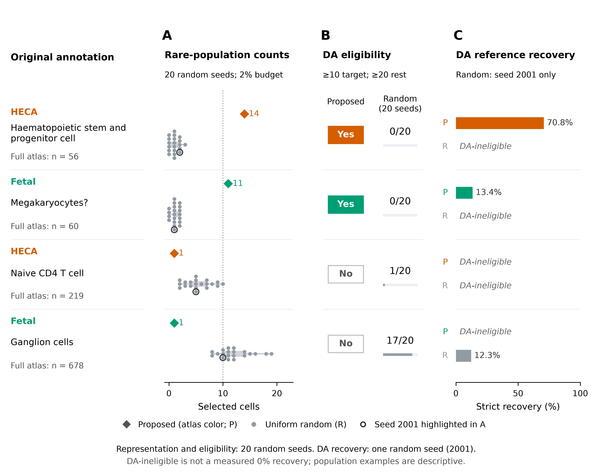

# Annotation-blind subset selection for large scATAC-seq atlases

A research workflow exploring whether a small subset of cells can retain useful biological information from a large single-cell chromatin-accessibility atlas—**without using cell-type labels to select cells**.

The project evaluates Kidney, HECA and Fetal atlases at **2%, 4%, 6%, 8% and 10% sampling budgets**, combining probabilistic representation learning, submodular optimization and downstream biological evaluation.

## Approach

1. **Learn a representation:** train PeakVI to obtain 60-dimensional cell embeddings.
2. **Construct features:** fit 1,024 MiniBatch K-means landmarks and compute cell-to-landmark RBF similarities.
3. **Select cells:** normalize each feature row to equal total mass, then use Apricot's square-root feature-based submodular objective with its default two-stage greedy optimizer.
4. **Evaluate:** measure population retention, enrichment/depletion, composition fidelity, latent-space coverage and differential-accessibility (DA) recovery. Compare against matched-budget uniform random sampling.

Cell-type annotations are used only after selection for evaluation and DA testing. The implementation combines Python, R, disk-backed BPCells matrices, and a Snakemake workflow executed through SLURM.

## Principal finding—and trade-offs

Selection can enrich some exceptionally rare populations enough to enable DA testing at small budgets. Other rare populations are depleted, uniform random sampling better preserves overall composition and typical-cell latent proximity in the recorded benchmarks, and DA fidelity is not uniformly improved.

Representation benchmarks include **20 random seeds**; the random DA pilot includes **one seed at 2% and 10%**. These are distinct evidence sets. The manuscript is in preparation; this repository does not claim universal sampling superiority.



*Main figure: selected enriched and depleted populations illustrate count differences, DA eligibility, and strict same-direction significant-peak recovery. Ineligible populations are distinguished from measured zero recovery. Random DA uses seed 2001 only.*

## Explore the project

| Location | Contents |
|---|---|
| [pseudocode.txt](pseudocode.txt) | End-to-end pipeline description and run commands |
| [Mathematical specification](docs/METHODS_MATHEMATICAL_FOUNDATION.md) | Objective, normalization, evaluation equations and limitations |
| [workflow/](workflow/) | Snakemake rules and compute-node controller |
| [scripts/](scripts/) | Preprocessing, PeakVI, selection and DA implementation |
| [publication_figures/FIGURE_INDEX.md](publication_figures/FIGURE_INDEX.md) | Main/supplementary figure map and source references |
| [env/](env/) | Environment specifications; see reproducibility note below |

## Running

The current execution scripts target the development SLURM cluster. **Adapt absolute paths, account/partition/GPU settings and Conda environments before running elsewhere.** Environment files are starting points, not a complete lockfile for every production environment. Input datasets and generated benchmark tables are not bundled.

```bash
# From the project root, with the required datasets/environments available:
sbatch workflow/run_pipeline.sbatch

# After successful completion, and with the saved diagnostic/benchmark inputs available:
sbatch publication_figures/figure_scripts/render_all_publication_figures.sbatch
```

The second command renders figures from existing results; it does not launch new selection, coverage or DA benchmarks. A fresh Snakemake run alone does not produce every historical diagnostic or benchmark required by the manuscript figures. See [pseudocode.txt](pseudocode.txt) for scope and dependencies.

## Repository scope

Source code, configuration, scientific documentation and the main figure are included. Large datasets, model artifacts, generated results, benchmark memberships, runtime logs, local archives and duplicate figure exports are excluded from Git. Refer to the original PeakVI and Apricot work for the established model and optimization components; this project studies their application with equal-mass landmark normalization and downstream scATAC evaluation.
